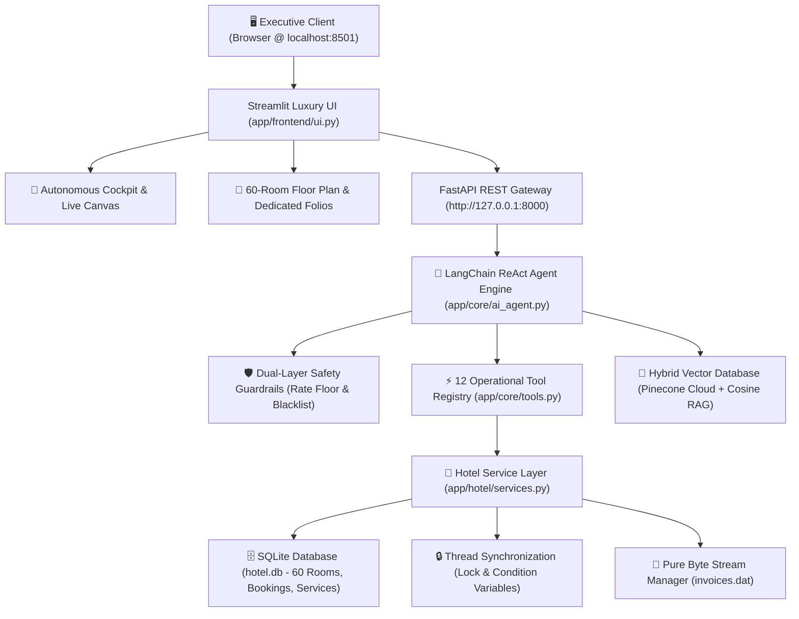

# 🏨 StayEase: Autonomous Multi-Role AI Agent Operating System
### **Hotel Apex Residency — Enterprise PMS, Billing & Housekeeping Coordinator**

[](https://www.python.org/)
[](https://fastapi.tiangolo.com/)
[](https://streamlit.io/)
[](https://www.langchain.com/)
[](https://www.pinecone.io/)
[](https://groq.com/)
[](https://www.sqlite.org/)

---

## 🌟 1. Executive Overview

**StayEase** is an enterprise-grade autonomous Hotel Management, Billing, Housekeeping Coordinator, and AI Concierge operating system developed for **Hotel Apex Residency** (a 60-room premier property across 3 floors).

Unlike traditional clerical website portals that require manual form entries, StayEase is architected as an **AI Agent-First Operating System**:
- The **StayEase AI Agent** acts as the primary operational controller across 5 leadership personas (Receptionist, General Manager, Hotel Owner, Housekeeping, Guest Support).
- Front desk guest self-service: Instant vacancy lookups, atomic booking allocations with ID & phone verification, zero-wait housekeeping dispatch, and in-room dining orders.
- Leadership & owner analytics: Dynamic yield metrics (Gross Revenue, ADR, RevPAR, 12% Luxury GST remittances), Plotly charts, night audits, and binary compliance backup.
- **60-Room Live Interactive Floor Plan**: Click any room card (`#101` to `#325`) to open a dedicated full-width room intelligence folio with preloaded customer data, itemized bills, in-room dining history, and 1-click AI food ordering.

---

## 🏗️ 2. System Architecture & Tech Stack



### Core Technologies:
- **Backend**: FastAPI, Uvicorn, SQLite3, Python `threading` & `struct` byte serialization.
- **Frontend**: Streamlit, Custom Light Luxury CSS Foundation (`#F8FAFC` base, `#0F172A` text, white `#FFFFFF` cards).
- **AI & Reasoning**: LangChain Core, Groq API (`openai/gpt-oss-20b`, `llama-3.3-70b-versatile`, `mixtral-8x7b-32768`), Tavily Web Search.
- **Vector Space**: Pinecone Cloud Serverless Index (`stayease-hotel-apex`) with In-Memory normalized Cosine Similarity fallback.

---

## 🚀 3. Key Operational Capabilities

### 🏢 60-Room Floor Plan & Dedicated Customer Folios
- Complete 60-unit property grid across 3 floors:
  - **Floor 1**: Rooms `101`–`115` (Standard @ ₹2,500/night)
  - **Floor 2**: Rooms `201`–`215` (Standard @ ₹2,500/night) & `216`–`220` (Deluxe @ ₹4,200/night)
  - **Floor 3**: Rooms `301`–`315` (Deluxe @ ₹4,200/night) & `316`–`325` (Suites @ ₹8,500/night)
- **1-Click Dedicated Separate Page**: Clicking any room card immediately opens the full-width customer folio without popup modals.
- **Pre-Loaded by Default**: Instant retrieval of guest names, phone numbers, ID proof (Aadhaar / Passport), dates, nights, and itemized billing (Room Rent + Food POS + 12% Luxury GST).
- **In-Room Dining via AI Agent**: 1-click specialty orders (*Hyderabadi Biryani ₹650*, *Breakfast Buffet ₹450*, *Cappuccino ₹300*, *Truffle Cake ₹350*) or natural language culinary orders that post directly to the active folio.

### 🤖 Multi-Role Autonomous AI Agent
| Persona / Authority | Primary Responsibilities & Armed Tools |
| :--- | :--- |
| **Receptionist** | Real-time vacancy inspection, atomic room booking, guest check-in, keycard issuance, knowledge base SOP queries. |
| **General Manager** | Occupancy rate monitoring, 20% Peak Surcharge audits, staff allocation to rooms, maintenance review, night audit tasks. |
| **Hotel Owner** | Executive financial metrics (Gross Realized Revenue, ADR, RevPAR, 12% Luxury GST collections), binary backup verification. |
| **Housekeeping** | Live cleaning queue, staff assignments (e.g. Ramesh, Sunita), turnaround tracking, 1-click room sanitization & release. |
| **Guest Support** | 24/7 in-room dining orders, Mercedes airport chauffeur scheduling, Ayurvedic spa reservations, pet & smoking policies. |

### 🛡️ Enterprise AI Guardrails
- **Prompt Injection Defense**: Blocks role bypass attempts, system prompt extraction, and security credential probing.
- **Rate Floor Enforcement**: Prohibits unauthorized discount hallucinations or $0 room offers; strictly adheres to hotel tariff structures.
- **Security Blacklist Check**: Cross-references guest identification proofs against blacklisted records (`BlacklistedGuestException`).
- **Settlement Guard**: Prevents guest check-out with unsettled balances (`PaymentPendingException`).

---

## 📁 4. Project Directory Structure

```text
llmops_class/
├── app/
│   ├── backend/
│   │   └── api.py                    # FastAPI REST endpoints (/chat, /stats, /health)
│   ├── common/
│   │   ├── custom_exception.py       # Centralized exception handlers
│   │   └── logger.py                 # Timestamped rotating logger
│   ├── config/
│   │   └── settings.py               # Pydantic v2 application settings & environment keys
│   ├── core/
│   │   ├── ai_agent.py               # LangChain ReAct multi-role AI agent engine
│   │   └── tools.py                  # 12 operational PMS execution tools
│   ├── frontend/
│   │   ├── assets/icons/             # 44px luxury Icons8 fluency badges
│   │   ├── components/
│   │   │   ├── navbar.py             # Top Agent OS navbar with 1-click sidebar toggle
│   │   │   ├── sidebar.py            # Operations sidebar console & persona switcher
│   │   │   ├── kpi_metrics.py        # 6 executive real-time telemetry cards
│   │   │   └── illustrations.py      # Embedded SVG vector art banners
│   │   ├── panels/
│   │   │   ├── agent_terminal.py     # AI agent command console & directive bar
│   │   │   ├── floor_plan.py         # 60-room grid & dedicated customer folios
│   │   │   ├── checkout.py           # In-house stays & checkout tax invoicing
│   │   │   ├── housekeeping.py       # Sanitization queue & staff assignments
│   │   │   ├── owner_analytics.py    # ADR, RevPAR, GST calculations & Plotly charts
│   │   │   └── vector_db_panel.py    # Pinecone Cloud & cosine similarity inspector
│   │   ├── styles.py                 # Custom light luxury CSS design foundation
│   │   └── ui.py                     # Streamlit application entry point
│   ├── hotel/
│   │   ├── binary_backup.py          # Pure byte-stream I/O (invoices.dat)
│   │   ├── chunker.py                # Hierarchical semantic windowing chunker
│   │   ├── database.py               # SQLite database DAO & smart collections loader
│   │   ├── guardrails.py             # Dual-layer safety & rate-floor engine
│   │   ├── models.py                 # Room, DeluxeRoom, Suite hierarchy & exceptions
│   │   ├── services.py               # Thread-safe business logic & atomic operations
│   │   ├── tasks.py                  # Housekeeping & night audit worker threads
│   │   └── vector_db.py              # Pinecone Cloud & in-memory vector database
│   └── main.py                       # Unified process launcher (FastAPI + Streamlit)
├── .env                              # Environment credentials (API keys)
├── .gitignore                        # Git ignore specifications
├── hotel.db                          # SQLite database pre-seeded with 60 rooms & folios
├── PROJECT_REPORT.md                 # Technical specification & syllabus mapping report
├── README.md                         # Project documentation
└── requirements.txt                  # Python dependencies
```

---

## ⚡ 5. Installation & Setup Guide

### 1. Prerequisites
- **Python**: Version 3.10, 3.11, or 3.12 (Strictly 100% Python, NO Java required).
- **Operating System**: Windows, macOS, or Linux.

### 2. Clone Repository & Setup Environment
```bash
# Clone the repository
git clone https://github.com/your-username/stayease-hotel-pms.git
cd stayease-hotel-pms

# Create virtual environment
python -m venv venv

# Activate virtual environment
# Windows (PowerShell):
.\venv\Scripts\Activate.ps1
# Linux / macOS:
source venv/bin/activate

# Install dependencies
pip install -r requirements.txt
```

### 3. Configure Environment Variables (`.env`)
Create a `.env` file in the root directory:
```env
# Groq LLM API Key (Required for AI Agent)
GROQ_API_KEY=gsk_your_groq_api_key_here

# Pinecone Cloud API Key (Optional - Fallback to in-memory cosine vector DB)
PINECONE_API_KEY=pcsk_your_pinecone_api_key_here
PINECONE_INDEX_NAME=stayease-hotel-apex

# Tavily Live Web Search (Optional)
TAVILY_API_KEY=tvly-your_tavily_api_key_here
```

### 4. Launch Application Stack

#### Option A: Direct Local Execution
Run the unified entry point which starts both the FastAPI backend and Streamlit UI:
```bash
python app/main.py
```

#### Option B: Docker Container Deployment
Run with Docker Compose (Recommended):
```bash
docker compose up --build
```
Or build and run standalone container:
```bash
# Build the Docker image
docker build -t stayease-ai-os .

# Run the container with environment file and exposed ports
docker run -d -p 8501:8501 -p 8000:8000 --env-file .env --name stayease stayease-ai-os
```

- **Streamlit Web UI**: [`http://localhost:8501`](http://localhost:8501)
- **FastAPI Backend**: [`http://127.0.0.1:8000`](http://127.0.0.1:8000)
- **Interactive Swagger Docs**: [`http://127.0.0.1:8000/docs`](http://127.0.0.1:8000/docs)

---

## 🧪 6. Sample Verified Console Commands & Workflows

### 1. Natural Language Room Booking via AI Agent
```text
User: "Book Deluxe room for Farhan, phone 9876543210, ID PASSPORT-A9901 for 2 nights."
StayEase AI: 
✅ Booking Confirmed!
Room: #304 (Deluxe, Floor 3) | Guest: Farhan (G179150)
Stay: 2 nights | Total Tariff: ₹9,408.00 (incl. 12% Luxury GST)
```

### 2. In-Room Dining Ordering
```text
User: "Order Hyderabadi Dum Biryani Feast for Room 208."
StayEase AI:
✅ Culinary Order Placed!
Dish: Hyderabadi Dum Biryani Feast (₹650.00) | Service ID: SRV-2026-0812
Posted to Room 208 active folio. Kitchen SLA: 15-20 minutes.
```

### 3. Housekeeping Staff Allotment
```text
User: "Allot Housekeeper Ramesh to clean Room 103."
StayEase AI:
🧹 Housekeeper Assigned!
Staff: Housekeeper Ramesh | Room: #103 | Status: Cleaning
Assignment ID: HK-2026-0419
```

### 4. Executive Financial Summary
```text
User: "Provide the executive financial summary with gross revenue, ADR, and RevPAR."
StayEase AI:
📊 Hotel Apex Residency — Financial Performance:
- Gross Realized Revenue: ₹417,272.80
- Total 12% Luxury GST Remitted: ₹44,707.80
- Average Daily Rate (ADR): ₹3,842.14
- Revenue Per Available Room (RevPAR): ₹2,689.50
- Current Occupancy: 70.0% (42 / 60 Units)
```

---

## 📜 7. License & Compliance
This software is built for educational, research, and enterprise hospitality management evaluations. All room allocations, billing algorithms, luxury tax remittances, and thread synchronization protocols conform to standard hospitality and accounting benchmarks.

